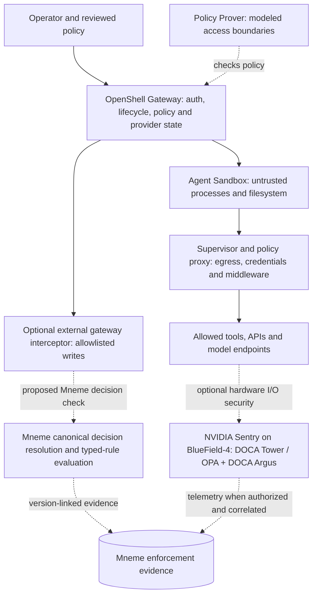

# NVIDIA OpenShell Reference Architecture: Technical Reference and Mneme Boundaries

**Status:** sourced external-architecture documentation, reviewed against NVIDIA documentation on 21 October 2026. **Not** a supported Mneme integration, deployment guide or partnership claim. Verify version-pinned APIs before implementation.

**Purpose:** separate the OpenShell open-source runtime from the larger NVIDIA reference architecture; explain NVIDIA Sentry, its policy interfaces and where Mneme *might* connect.

## 1. What NVIDIA actually provides

NVIDIA uses two related product boundaries:

1. **OpenShell open-source runtime**: untrusted agent runs in a sandbox; a supervisor outside its process mediates access; a gateway owns sandbox lifecycle, credentials and policy state; a policy prover checks *modeled access permissions* against operator-defined bounds. The runtime can be deployed without NVIDIA BlueField hardware.
2. **NVIDIA OpenShell Reference Architecture / Open Agent Safety Platform**: combines this runtime with Vera CPUs for agent workloads, AI compute for inference and **optional NVIDIA Sentry on BlueField-4 DPUs** for independent, hardware-isolated monitoring/enforcement. It is a reference architecture, not a statement that every OpenShell installation has NVIDIA Sentry.

Source: [NVIDIA press announcement (2026-10-21)](https://nvidianews.nvidia.com/news/openshell-reference-architecture), [architecture technical walkthrough](https://developer.nvidia.com/blog/how-nvidia-openshell-reference-architecture-secures-and-governs-ai-agent-workloads-at-scale/), [OpenShell overview](https://www.nvidia.com/en-us/ai/openshell/).

### Logical architecture (conceptual, not a vendor deployment diagram)

Diagram caveat: it shows *possible* external Mneme integration points. **No Mneme/OpenShell/Sentry adapter has been implemented or validated here.** Sentry sits in a separate BlueField hardware trust domain where provisioned, not inside the ordinary OpenShell gateway.

## 2. Runtime responsibilities

| Component | What NVIDIA documents | What it does not prove |
|---|---|---|
| Gateway | Authenticates API clients; manages sandboxes, policies, providers and runtime settings; delegates compute creation; selected gRPC mutation interception extension | Doesn't see all agent-local file writes or independently know engineering decisions |
| Sandbox / isolation backend | Limits agent process privileges, filesystem visibility and network access; underlying controls include Landlock/LSM and runtime process settings where supported | Filesystem access authorization is not semantic code-change conformance |
| Supervisor & policy proxy | Policy-enforced egress; selected protocol-level API permissions; managed credential injection; configurable HTTP/WebSocket middleware | A permitted request can still be architecturally wrong if no matching rule exists at this boundary |
| Policy Prover | SMT-based proof for modeled access permissions inside a boundary; separately assesses certain risky network-policy changes | Does not prove business logic, application architecture or functional correctness |
| Gateway interceptors | External gRPC extension with `modify_operation`, `validate` and observational `post_commit` for **explicitly allowlisted unary write RPCs** | Not general interception for `write_file`, raw shell or arbitrary application deployment APIs |
| NVIDIA Sentry (optional) | Host-isolated security and monitoring framework on BlueField-4 using DOCA; access-policy controls and activity evidence | Not a replacement for a reviewed, versioned repository decision index |

Sources: [Gateway Interceptors](https://docs.nvidia.com/openshell/latest/extensibility/gateway-interceptors), [OpenShell Extensibility](https://docs.nvidia.com/openshell/latest/extensibility/overview), [Policy Prover](https://docs.nvidia.com/openshell/latest/how-it-works/policies/prover), [Sentry technical architecture](https://developer.nvidia.com/blog/inside-nvidia-sentry-secure-ai-agents-at-runtime/).

## 3. Policy semantics: three different things

**A. OpenShell sandbox policy** specifies *what the workload may access*. YAML `version: 1` defines filesystem permissions, Landlock compatibility, process identity, network permissions and network middleware. Filesystem, Landlock and process settings are static at sandbox creation; network/middleware settings may be updated dynamically. Default-deny egress is central.

**B. OpenShell policy source / effective policy** controls *which policy actually operates*. As of documented v0.1.5:
- A gateway-wide **global policy replaces** individual sandbox policies while active, rather than just acting as an intersecting upper bound.
- Otherwise the sandbox's saved policy (including explicitly supplied startup policy) precedes an image policy and restrictive fallback.
- Attached provider profiles may contribute network permissions to the **effective** policy. Do not infer effective authority from the base YAML alone.
- The Policy Prover checks a policy against modeled access bounds. It does not make an engineering decision authoritative.

**C. Mneme engineering decisions** identify *which architectural intentions are authoritative for a repository/context*, their source, scope, precedence, lifecycle, exceptions and rule lineage. Mneme's verified typed rules enforce only what the current evaluator can actually express. An architectural decision like 'handlers use the repository storage adapter' is not equivalent to 'sandbox may write to src/handlers'.

Sources: [Sandbox Policies](https://docs.nvidia.com/openshell/latest/how-it-works/policies/overview), [Policy Schema](https://docs.nvidia.com/openshell/latest/reference/policy-schema), [Policy Prover](https://docs.nvidia.com/openshell/latest/how-it-works/policies/prover).

## 4. NVIDIA Sentry and OPA

**NVIDIA Sentry is not Sentry.io.** NVIDIA Sentry runs on **BlueField-4** and is based on the NVIDIA **DOCA** ecosystem:
- **DOCA Tower**, an Envoy-based AI security gateway, uses **Open Policy Agent (OPA) / Rego** in the hardware-isolated enforcement stack for controlled traffic.
- **DOCA Flow** supports L4 filtering; Tower can inspect policy-permitted L7 traffic.
- **DOCA Argus** supplies out-of-band memory/runtime context.
- Attested/tamper-evident telemetry and threat response are part of NVIDIA's claimed design.

Sentry can extend infrastructure access policy with hardware-backed controls. It does not establish that a Mneme decision can be natively converted into Sentry's OPA rules. **A direct Mneme → Rego → Sentry policy bridge is an unvalidated research hypothesis**, and must not be described as shipped.

Source: [Inside NVIDIA Sentry](https://developer.nvidia.com/blog/inside-nvidia-sentry-secure-ai-agents-at-runtime/), [Open Agent Safety Platform (2026-09-28)](https://developer.nvidia.com/blog/nvidia-open-agent-safety-platform-a-reference-for-continuous-in-silicon-agent-monitoring).

## 5. Plausible Mneme integration points, ranked

| Research surface | Candidate value | Important boundary | Status |
|---|---|---|---|
| **Gateway interceptor** | Review allowable `CreateSandbox`, `UpdateConfig`, policy/profile changes against a reviewed decision and approved profile | Intercepts **only configured allowlisted RPCs**; `post_commit` cannot deny. Configure `fail_closed` only on a supported pre-action phase and audit outage behavior | Proposed |
| **Agent coding harness + Mneme existing hook** | Check actual proposed code change for typed architecture constraints at the supported mutation seam, then use OpenShell to restrict the agent's environment | Does not inherit a universal file-write seam from OpenShell; raw shell and remote writes may bypass | Proposed combination of existing Mneme interface + separate OpenShell runtime |
| **CI verification** | Detect remaining checked violations on the actual final diff | Detection at CI is not automatically a pre-mutation block | Existing Mneme interface; OpenShell pairing untested |
| **Supervisor middleware** | Narrow policy on particular allowed API calls and relate a safe request to an applicable decision | Runs **after** OpenShell's access policy and before managed credentials; HTTP/WebSocket only in documented extension | Proposed |
| **OCSF / traces / Sentry telemetry** | Correlate OpenShell security events to Mneme decision and rule revision, target and final verdict | Event identity, retention, integrity and cross-stream correlation unverified; avoid source-code egress | Proposed |
| **Direct OPA/Rego projection** | Potential policy export where verified decisions map exactly onto supported access predicates | No generic semantic compiler, no automatic ADR → security policy. Requires equivalence tests, safe failure, ownership and version pins | Deferred |

## 6. Proposed minimal proof (not executed)

Pin one OpenShell release and sandbox fixture. Use two human-reviewed decisions: (1) storage adapter required for application handlers, (2) no new GPU/model allocation without approval. Run OpenShell alone, then OpenShell + Mneme, holding task and inputs stable where possible.

Include compliant edits, forbidden import, forbidden resource request, benign comment false-positive, raw-shell/local-write bypass, unsupported RPC, policy-revision mismatch, lost target binding, denied/expired exception and unavailable interceptor. Record **ALLOW, DENY, UNEVALUATED** explicitly at each supported boundary; run CI independently. Score functional completion, architectural compliance, false blocks, escapes, reviewer effort, latency and evidence completeness.

The second decision is valid for a *gateway* experiment only if the resource operation is visible through an actually interceptable OpenShell RPC. Otherwise evaluate at the separate deployment admission gate or mark OpenShell pre-action enforcement **UNEVALUATED**. No invented full coverage.

**Go/no-go:** a documented mandatory seam, a measurable improvement in semantic decision conformance over native OpenShell access controls, safe failure behavior, correct decision/rule/target revision binding and a reproducible evidence packet.

## 7. Content and link architecture

- Public explanatory architecture document: this document, initially a repository reference. A future rendered guide should focus on OpenShell as a third-party architecture without implying Mneme endorsement.
- Public **integration** page proposed at `/integrations/nvidia-openshell/`: clearly labeled *Exploration / not yet available*. It is not a setup guide until there is a real working adapter.
- Separate **policy interoperability** content at a planned `/integrations/policy-engines/` or scoped concept/insight depending on test results. Distinguish OpenShell sandbox YAML, Sentry OPA/Rego and Mneme decision semantics; do not publish fake install steps.
- Existing related content: `/concepts/policy-as-code/`, `/insights/programmable-ai-policy-executable-architectural-intent/`, `/insights/agent-runtime-governance/`.

**Portfolio anchors:** Core DG1 [#497](https://github.com/MnemeHQ/mneme/issues/497), CI1 [#540](https://github.com/MnemeHQ/mneme/issues/540), governance trace [#282](https://github.com/MnemeHQ/mneme/issues/282), private roadmap intake [growth-ops #73](https://github.com/MnemeHQ/mneme-growth-ops/issues/73).

**Update trigger:** revisit on an OpenShell version change, confirmed extension interface, proven adapter or NVIDIA Sentry policy/evidence contract change.
